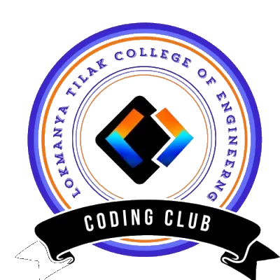

<div align="center">



# CCLTCE

**Minecraft-themed website for the Coding Club at Lokmanya Tilak College of Engineering**

*WebGL Narrative Journey • Voxel Aesthetics • Community Platform • Gamified Challenges*

[](#)
[](#)
[](#)
[](#)
[](#)
[](#)
[](#)
[](#license)

</div>

---

<div align="center">

### CCLTCE — CODING CLUB, LTCOE
**MINECRAFT VOXEL WORLD • WEBGL NARRATIVE • LIVE COMMUNITY HUB**

[Zero Build Step](#local-dev) · [Vanilla JS](#tech-stack) · [13 Pages](#pages) · [Desktop 3D + Mobile fallback](#performance)

</div>

## Overview

**CCLTCE** is the official website of the Coding Club at *Lokmanya Tilak College of Engineering* (LTCE), Navi Mumbai — reimagined as a **playable Minecraft world**. Instead of a boring scrolling landing page, visitors ride a **scroll-driven Three.js narrative journey** through Overworld → Nether → End biomes, complete with breakable obsidian crystals, a boss dragon, voxel clouds, and tool-shaped cursors.

Beyond the spectacle, it is a fully functional **community platform**: accounts, teams with an interactive org tree, an inbox-style community board, event listings, curated resources, weekly coding challenges with a live code editor, a terminal, a pixel-art editor, and gamified XP/achievements — all backed by **Supabase** (auth + Postgres + RLS).

Built with **zero build step** — plain HTML, CSS, and ES-module JavaScript. No React, no bundler, no framework. Deployed on **Vercel** as a pure static site.

## Tech Stack

| Layer | Choice | Why |
|---|---|---|
| Markup / Style / Logic | HTML5 · CSS3 · vanilla ES modules | Zero build step, instant deploys, easy onboarding |
| 3D Narrative | **Three.js** (lazy-loaded, desktop-only) | Scroll-driven biome journey without shipping 656KB to phones |
| Animation | **GSAP** | Menus, tab swaps, hero bob, click FX |
| Backend | **Supabase** (Auth + Postgres + RLS) | Accounts, teams, community, XP — no server to run |
| Hosting | **Vercel** (static) | Clean URLs, asset caching, web analytics |
| Fonts | Press Start 2P · JetBrains Mono | Minecraft flavor + dev-tool legibility |

## Pages

| Page | What it does |
|---|---|
| `/` (index) | WebGL narrative journey, voxel clouds, hero scene |
| `/team` | Core team with interactive org tree |
| `/community` | Inbox, member directory, board (GSAP tab transitions) |
| `/events` | Club events & hackathons |
| `/notices` | Announcements feed |
| `/resources` | Curated learning tracks |
| `/achievements` | Member wins |
| `/challenges` | Weekly coding challenges + live editor + terminal |
| `/dashboard` | Gamified user dashboard (XP, stats) |
| `/login` · `/register` | Supabase auth |

## Features

- **Scroll-driven 3D journey** — Overworld → Nether → End biomes with smooth camera blending across a 1100vh canvas
- **Breakable End crystals** — click obsidian-pillar crystals to detonate them, drop the dragon's healing beams, and earn XP
- **Voxel Minecraft clouds** — chunky JS-generated cube stacks that drift and float away as you scroll
- **Tool cursors** — sword / pickaxe / axe CSS cursors replace the boring default pointer
- **Interactive org tree** — team hierarchy you can expand, collapse, and navigate
- **Community hub** — inbox-style messaging, member directory, discussion board
- **Gamification** — XP, levels, achievements across challenges and participation
- **Built-in playgrounds** — live code editor, retro terminal, pixel-art editor
- **Performance-aware** — Three.js is lazy-loaded and skipped entirely on phones, tablets, and `prefers-reduced-motion`
- **Accessible & SEO-ready** — dark color-scheme, JSON-LD structured data, Open Graph / Twitter cards, sitemap, robots.txt, PWA manifest

## Local Dev

```bash
git clone git@github.com:SachinyadavAug20/ccltce-site.git
cd ccltce-site
npm run dev
# → http://localhost:3000
```

Requires **Node ≥ 18**. No install step — `npm run dev` serves the static root directly.

## Deploy on Vercel

1. Push this repo to GitHub.
2. Go to [vercel.com/new](https://vercel.com/new) → Import Git Repository → select `ccltce-site`.
3. Vercel auto-detects the static site (no build command needed). Click **Deploy**.
4. Optional: set a custom domain under Project → Settings → Domains.

`vercel.json` is already configured for clean URLs, asset caching, and security headers.

## Supabase Setup

1. Create a project at [supabase.com](https://supabase.com).
2. Run the SQL files in `supabase/` in this order via **SQL Editor**:
   - `schema.sql`
   - `seed-team.sql`
   - `migration-community.sql`
   - `migration-avatars.sql`
   - `migration-fun.sql`
   - `migration-pixel-art.sql`
   - `migration-rls-fix.sql` ← **required** (fixes recursive RLS policy on `teams`)
3. Fill your project URL + anon key in `assets/js/supabase-config.js` (the anon key is public by design — protect data with RLS, never ship the `service_role` key).

## Structure

```
├── *.html                  # 13 pages (index, team, community, events, …)
├── assets/
│   ├── css/                # 15 stylesheets, one concern each (≤150 lines)
│   ├── js/                 # 50+ ES modules (narrative-*, community, auth, …)
│   ├── fonts/              # Press Start 2P + JetBrains Mono (woff2, self-hosted)
│   ├── img/                # logos, favicons, avatars
│   └── vendor/             # three.module.js · gsap.min.js · supabase.min.js
├── data/content.json       # team / events / notices content
├── supabase/               # schema + migrations + RLS fixes (SQL)
├── server/                 # optional Express backend (not needed on Vercel)
└── vercel.json             # clean URLs + cache + security headers
```

## License

Apache 2.0 — see the repository for details.
